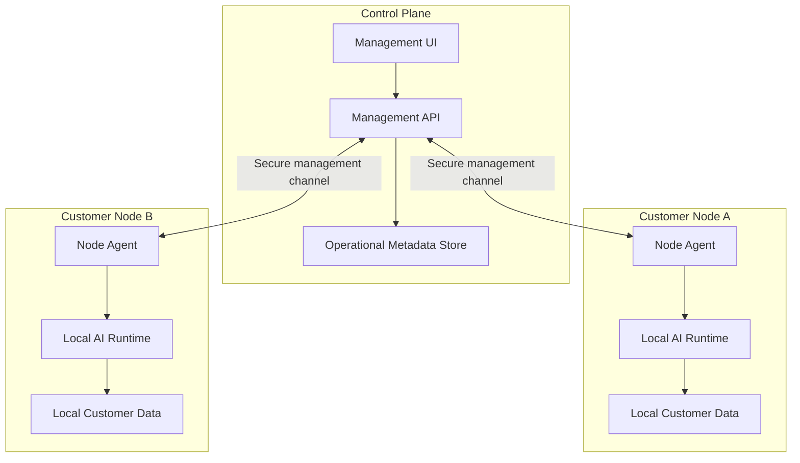

# System Architecture Overview

## Overview

Local AI Control Plane is a distributed system composed of:

- A central **Control Plane**.
- Multiple isolated **Customer Nodes** running on customer-controlled infrastructure.

The Control Plane manages operational metadata and node lifecycle information.

Customer Nodes run local AI workloads and keep customer-specific data inside the customer environment.

The core architectural principle is:

> Centralize infrastructure management without centralizing customer AI data.

---

## High-Level Architecture

Each Customer Node represents an independent deployment and security boundary.

Customer-specific data remains inside its corresponding node.

---

## Control Plane

The Control Plane is the centralized management layer of the system.

Its responsibilities include:

- Registering nodes.
- Maintaining node identities.
- Tracking node availability.
- Receiving health information.
- Tracking software versions.
- Tracking installed model metadata.
- Managing node configuration.
- Sending authorized management operations.
- Providing a management API.
- Providing an operator-facing web interface.
- Persisting operational metadata.

The Control Plane should not store customer business documents, embeddings, prompts, or AI conversations.

---

## Management UI

The Management UI is the operator-facing interface.

It may eventually display:

- Node inventory.
- Node status.
- Last heartbeat.
- Software version.
- Installed model information.
- Resource usage.
- Deployment state.
- Available management actions.

The UI communicates with the Control Plane API.

It does not communicate directly with Customer Node internal services.

---

## Management API

The Management API coordinates Control Plane operations.

Its responsibilities include:

- Authenticating operator requests.
- Authenticating node communication.
- Managing node metadata.
- Persisting operational state.
- Exposing management operations to the UI.
- Coordinating communication with Node Agents.

The exact communication protocol between the Control Plane and Customer Nodes is intentionally deferred.

---

## Operational Metadata Store

The Control Plane requires persistent storage for infrastructure metadata.

Expected data includes:

- Customer identifiers.
- Node identifiers.
- Node registration state.
- Node status.
- Last heartbeat.
- Software versions.
- Installed model metadata.
- Hardware information.
- Resource utilization.
- Deployment configuration.

Customer AI data must not be stored here as part of the MVP architecture.

---

## Customer Node

A Customer Node is an independent AI environment running on customer-controlled infrastructure.

Possible deployment targets include:

- On-premise servers.
- Workstations.
- Dedicated AI appliances.
- Virtual machines.
- Other compatible customer-controlled machines.

Each node owns its local AI runtime, configuration, and customer data.

---

## Node Agent

The Node Agent is responsible for management communication between the Control Plane and the Customer Node.

Its responsibilities will eventually include:

- Node registration.
- Maintaining node identity.
- Sending periodic heartbeats.
- Reporting system health.
- Reporting software and model versions.
- Receiving authenticated management operations.
- Applying local configuration changes.
- Reporting operation results.

The Node Agent should expose only the management capabilities required by the platform.

---

## Local AI Runtime

The Local AI Runtime executes AI workloads inside the Customer Node.

Its future responsibilities may include:

- Running local language models.
- Handling inference requests.
- Generating embeddings.
- Supporting local RAG workflows.
- Serving local AI APIs.

The specific inference runtime is intentionally not selected in this milestone.

---

## Local Customer Data

Customer-specific AI data remains inside the Customer Node.

This may include:

- Source documents.
- Extracted document content.
- Embeddings.
- Vector indexes.
- Prompts.
- Conversation history.
- Retrieved context.
- Customer application data.

The Control Plane does not require direct access to this data.

---

## Data Boundaries

The architecture distinguishes between two categories of data.

### Operational Metadata

Operational metadata may be transmitted to and stored by the Control Plane.

Examples:

- Node status.
- Last heartbeat.
- Runtime version.
- Installed model names.
- CPU utilization.
- Memory utilization.
- Disk utilization.
- Deployment state.

### Customer Data

Customer-specific business and AI data remains local to the Customer Node.

Examples:

- Documents.
- Embeddings.
- Prompts.
- Conversations.
- Retrieved context.
- Business records.

This separation is a core architectural constraint.

---

## Trust Boundaries

### Control Plane Boundary

The Control Plane is a privileged management environment.

Access to management functionality must eventually be authenticated and authorized.

### Customer Node Boundary

Each Customer Node is an independent security boundary.

The node should expose only the minimum functionality required for local AI workloads and remote management.

### Customer Isolation Boundary

Customer Node A must not have access to Customer Node B's environment or customer data.

Shared management infrastructure must not imply shared customer data.

### Management Communication Boundary

Communication between the Control Plane and Node Agent crosses a network trust boundary.

The final implementation must provide:

- Authentication.
- Confidentiality.
- Integrity.
- Least-privilege access.

The specific mechanism is intentionally deferred.

---

## Network Assumptions

Customer Nodes may operate behind:

- NAT.
- Firewalls.
- Private business networks.
- Residential or small-business Internet connections.

The architecture should not depend on publicly exposing management ports directly to the Internet.

A secure management communication mechanism will be selected later.

---

## Failure Isolation

The architecture should contain failures to individual components or nodes where possible.

Examples:

- A failed Customer Node should not affect other Customer Nodes.
- A Local AI Runtime failure should not make the Control Plane unavailable.
- Loss of management connectivity should not expose customer data.
- Compromise of one Customer Node should not automatically provide access to other nodes.

---

## Initial System Flow

A future end-to-end management flow may look like:

1. A Customer Node is installed.
2. The Node Agent establishes its identity.
3. The Node Agent registers with the Control Plane.
4. The Node Agent periodically sends health information.
5. The Control Plane stores operational metadata.
6. An operator views the node through the Management UI.
7. The operator requests a management action.
8. The Control Plane authorizes the operation.
9. The Node Agent receives and applies the operation.
10. The Node Agent reports the result.

Customer AI data does not need to participate in this management flow.

---

## Deferred Decisions

The following decisions are intentionally deferred:

- Control Plane framework.
- Customer Node framework.
- Local inference runtime.
- Control Plane ↔ Node protocol.
- Private networking technology.
- Primary database technology.
- Vector storage technology.
- Authentication mechanism.
- Deployment platform.
- Update delivery mechanism.
- Observability stack.

These decisions should be documented later through Architecture Decision Records when required.
